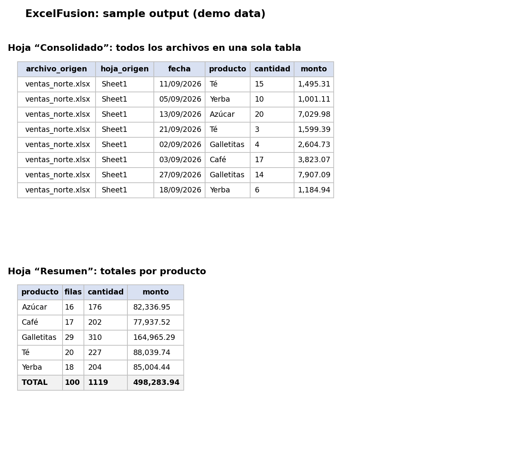

<p align="center">
  <picture>
    <source media="(prefers-color-scheme: dark)" srcset="assets/logo_reverse.svg">
    
  </picture>
</p>

<h3 align="center">Many files. One report.</h3>

<p align="center"><a href="https://excelfusion.streamlit.app"><b>Try the live app</b></a></p>

Merge dozens of messy Excel and CSV files into one clean report, in seconds.

Stop copy-pasting between spreadsheets. ExcelFusion reads every `.xlsx`, `.xls` and `.csv` file in a folder, standardizes the column names, combines everything into one table and builds a ready-to-share Excel report.

## What you get



The output workbook has four sheets (five if you used the data cleaning):

| Sheet | Content |
|---|---|
| **Dashboard** | KPI tiles and two native Excel charts (ranking and trend) built from the same selection you see in the web app. The charts read the data tables below them, so you can edit them in Excel |
| **Consolidado** | All rows from all files, with the source file and sheet of each row |
| **Resumen** | Totals per group (per file by default, or per any column you choose) |
| **Limpieza** | Only when the cleaning changed something: summary of every action and the rows that were removed, so you can review them |
| **Registro** | What was read, what failed, empty sheets skipped and columns missing in some files |

## Features

- Reads all sheets of every Excel file, plus CSVs (comma, semicolon or tab separated, UTF-8 or Latin-1)
- **Finds the header row by itself**: skips report titles, blank rows and leading notes
- **Skips total rows** ("Total", "Subtotal", "Grand total") so sums are not counted twice; you can turn it off
- Understands numbers in both formats: `1,234.56` and `1.234,56`
- **Column mapping**: suggests which columns from different files are the same thing (`Importe neto`, `Total` and `Monto` become one) and lets you edit the names before merging
- Removes accents, punctuation and extra spaces from headers
- **Data cleaning**: trims extra spaces, unifies spelling variants (`Café`, `CAFÉ` and `cafe` become one, keeping the most common spelling), and can remove duplicate rows and flag rows with missing data. Every change is logged and removed rows get their own sheet
- Parses date columns (day-first format)
- Skips empty sheets and reports corrupt files instead of crashing
- Dashboard with KPIs and charts in the web app (see below)
- Formatted output: bold headers, filters, frozen top row, auto-sized columns

## Quick start

```bash
pip install -r requirements.txt

# 1. Generate sample messy files (optional)
python generar_datos_demo.py

# 2. Consolidate a folder
python consolidar_excels.py datos_demo

# Group the summary by a column and choose the output name
python consolidar_excels.py datos_demo --agrupar producto -o ventas_septiembre.xlsx
```

Want to see the header detection and the column mapping at work? Use the three intentionally messy files in [`ejemplos_desordenados/`](ejemplos_desordenados): titles above the table, a `;`-separated CSV with decimal commas, different column names and "Total" rows.

## Web app (no command line needed)

Prefer a point-and-click version? Run the Streamlit app, upload your files, pick how to group the summary and download the report:

```bash
streamlit run app.py
```

## Data cleaning (web app)

Open **Data cleaning** below the column mapping. Nothing disappears silently:

| Option | What it does | Default |
|---|---|---|
| Trim extra spaces | Removes leading, trailing and repeated spaces; blank text becomes "missing" | On |
| Unify spelling variants | Merges `Café` / `CAFÉ` / `cafe` into the most common spelling so category totals do not split | On |
| Remove duplicate rows | Only inside each file, or across all files. Removed rows go to the **Limpieza** sheet | Off |
| Flag missing data | Adds a `datos_faltantes` column naming the empty fields of each row. Nothing is deleted | Off |

Try it with `ejemplos_desordenados/ventas_sucias.xlsx`.

## Dashboard and KPIs (web app)

The **Dashboard** tab turns the merged data into indicators and charts. Pick what to measure and how to slice it:

- **Metric:** any numeric column (amount, quantity...)
- **Category:** any text column (product, client, branch... or source file)
- **Date and period:** view the evolution by day, week or month
- **Filters:** choose categories, date range and how many items to show in the ranking

It shows total, average, number of records, the top category with its share, the best period, a ranking bar chart and a time-series line chart.

The downloaded Excel opens on a **Dashboard** sheet with the same indicators and native Excel charts, using the metric, category, period and filters you chose.

## Brand

Logo, colors and typography are documented in [BRAND.md](BRAND.md).

## Customize

Different column names in your files? Add them to the `ALIAS` dictionary at the top of `consolidar_excels.py`:

```python
ALIAS = {
    "importe": "monto",
    "cant": "cantidad",
    # "your_column": "standard_name",
}
```

## Need this adapted to your files?

I build custom Excel automation, reports and dashboards (Excel, SQL, Power BI, Python). Contact: [github.com/berruttigino](https://github.com/berruttigino)

---

# ExcelFusion (Español)

Une decenas de archivos Excel y CSV desordenados en un único reporte limpio.

**Uso rápido:** `pip install -r requirements.txt` y luego `python consolidar_excels.py carpeta_con_archivos`. El resultado es un Excel con las hojas *Consolidado*, *Resumen* y *Registro*.
